## ⚙️ Technologies

&nbsp; &nbsp; &nbsp; &nbsp; &nbsp; &nbsp; &nbsp; &nbsp; &nbsp; &nbsp; &nbsp; &nbsp; &nbsp;

## 🦇 Sobre mim

Sou desenvolvedor apaixonado por criar produtos completos, do visual ao back-end: sites, apps desktop e sistemas em tempo real.
Hoje trabalho com **Next.js, Electron e Supabase**, e estou sempre estudando matemática, física, segurança e performance.

**O que eu quero:** construir projetos cada vez maiores, entrar no mercado de tecnologia e lançar o meu próprio produto.

## 🌊 Árvore de Skills

